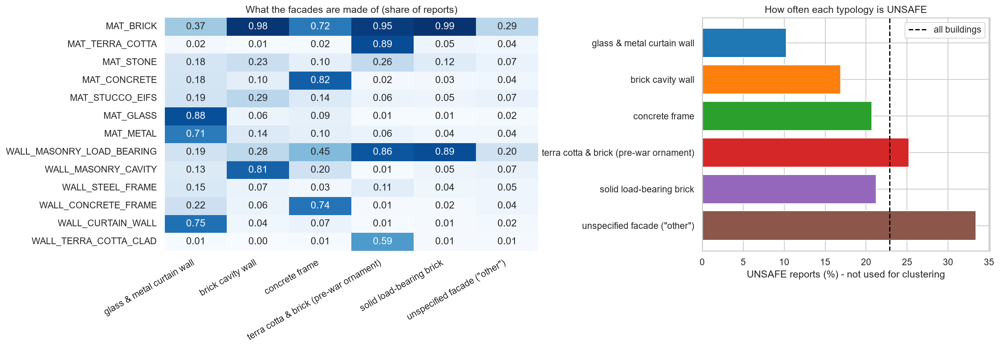
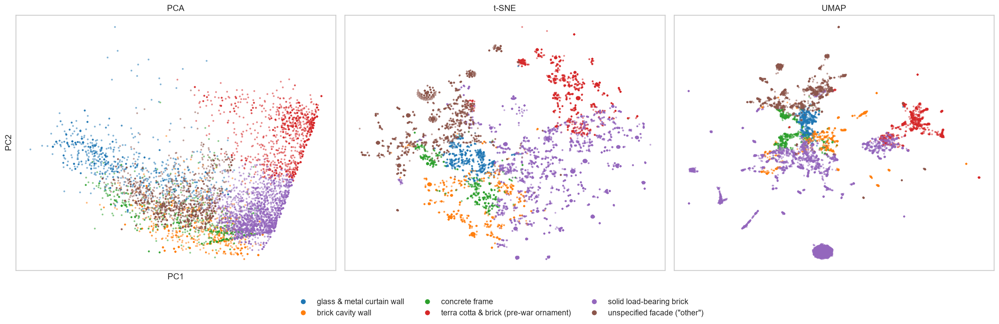

# NYC facade typologies: clustering the buildings of the facade inspection programme

**Team:** Amelia, Jerome, Kazuko, Sahil
**Course:** AI Methods I – Day 3: Unsupervised learning (IAAC MaAI 2026/27)
**Dataset on Hugging Face:** https://huggingface.co/datasets/iaac-maai/day3-team1-nyc-facade-typologies
**Model on Hugging Face:** https://huggingface.co/iaac-maai/day3-team1-facade-typologies

## Use case

Facades of the same type fail in the same way: terra cotta cracks, brick spalls, curtain-wall sealants age, concrete frames lose their cover. We group New York City's tall buildings into **facade typologies** so that the NYC Department of Buildings (DOB) or a facade consultant planning an inspection cycle can **send the right specialist**, plan **typical repairs per typology**, and see **which typologies are UNSAFE most often**. A group is useful if a facade engineer can name it and if it behaves differently in the inspections.

On Day 2 we predicted *how risky* a facade is; today we ask *what kind of facade* it is.

## Dataset

| | |
|---|---|
| **Name** | DOB NOW: Safety – Facades Compliance Filings (same dataset as Days 1 and 2) |
| **Source** | [NYC Open Data, data.cityofnewyork.us/d/xubg-57si](https://data.cityofnewyork.us/d/xubg-57si) |
| **Our clustered version** | [iaac-maai/day3-team1-nyc-facade-typologies](https://huggingface.co/datasets/iaac-maai/day3-team1-nyc-facade-typologies) |
| **Rows used** | 87,556 filings → 52,245 initial reports with a facade description → **15,747 buildings** (one row = one building) |
| **Coverage** | New York City, buildings taller than 6 stories, FISP cycles 6–10 (about 2006–2026), downloaded 2026-10-30 |
| **Licence** | NYC Open Data [terms of use](https://www.nyc.gov/home/terms-of-use.page) (free public use). Owner and inspector contact details are removed before publishing |

The raw data is not committed: the notebook downloads it from NYC Open Data.

## Repository structure

```
├── data/                     # raw data, downloaded by the notebook (not committed)
├── dataset/
│   ├── README.md             # the Hugging Face dataset card
│   ├── dataset_*.png         # the figures shown in the dataset card
│   └── nyc_facade_typologies.csv   # the clustered dataset (not committed: on Hugging Face)
├── figures/                  # all exported plots (01–10)
├── models/
│   ├── README.md             # the Hugging Face model card
│   └── model.joblib          # the fitted pipeline (not committed: on Hugging Face)
├── notebook/
│   └── unsupervised_learning.ipynb   # download, cleaning, clustering, interpretation, export
├── .gitignore
├── LICENSE
├── README.md
└── requirements.txt          # pinned package versions
```

## How to run

```bash
python -m venv .venv
source .venv/bin/activate        # Windows: .venv\Scripts\activate
pip install -r requirements.txt
```

Open `notebook/unsupervised_learning.ipynb`, select the `.venv` kernel and run all cells (a few minutes; t-SNE is the slowest step). The notebook downloads the data, repeats our Day 2 cleaning, and writes `dataset/nyc_facade_typologies.csv`, `models/model.joblib` and the figures. We use the same dataset as on Day 2, so there is only one notebook.

To only use the results, download the dataset or the model from Hugging Face (see the cards for code examples).

## Approach

- **Unit of analysis:** one row = one building (`BIN`). The original table has one row per inspection report; we aggregate the **initial** reports of each building (up to one per 5-year cycle).
- **Features clustered on (13):** the share of a building's reports that list each of 7 **material families** (brick, terra cotta, stone, concrete, stucco/EIFS, glass, metal) and 6 **wall families** (load-bearing masonry, cavity wall, steel frame, concrete frame, curtain wall, terra cotta cladding), grouped from the 18 wall types and 12 materials of the reports.
- **Kept aside for interpretation:** borough, inspection history (`SHARE_UNSAFE`, `EVER_UNSAFE`, `LATEST_STATUS`, penalties), years in the programme, and the "OTHER" shares.
- **Preprocessing:** no scaling. All features are shares between 0 and 1 (the same unit); a `StandardScaler` would make rare families such as glass weigh much more than brick.
- **Methods:** PCA (6 components for 80% of the variance), t-SNE and UMAP; K-Means (k = 2–10, elbow and silhouette) and Ward hierarchical clustering (dendrogram); stability over 10 seeds and 10 subsamples of 80%.
- **Final choice:** **K-Means, k = 6**: the silhouette has a clear peak at k = 6 (0.38, against 0.24 for Ward), the clusters are very stable (ARI 0.99), they can be named, and K-Means can assign new buildings.

## Results

| Cluster | Name | Size | Defining features | UNSAFE reports* |
|---|---|---|---|---|
| 0 | glass & metal curtain wall | 951 (6%) | glass, metal, curtain wall; 75% Manhattan | **10%** |
| 1 | brick cavity wall | 1,530 (10%) | brick on a cavity wall, stucco/EIFS; spread over Brooklyn and the Bronx | 17% |
| 2 | concrete frame | 769 (5%) | concrete, concrete frame | 21% |
| 3 | terra cotta & brick (pre-war ornament) | 1,890 (12%) | terra cotta with brick and stone; 88% Manhattan | 25% |
| 4 | solid load-bearing brick | 7,665 (49%) | plain load-bearing brick, nothing else | 21% |
| 5 | unspecified facade ("other") | 2,942 (19%) | inspectors wrote "OTHER" in 70% of reports | **33%** |

\* Share of the buildings' initial reports with an UNSAFE result: **not used for clustering** (average over all buildings: 23%).



Although the algorithm never saw the inspection results, the typologies **differ in risk**: curtain walls are UNSAFE in 10% of reports, terra cotta buildings in 25%. The buildings described only as "OTHER" have the worst record (33% UNSAFE, 64% at least once).



The PCA map is a V shape: traditional brick on the right, terra cotta going up, glass and metal on the left. Curtain-wall and terra cotta buildings are found by both algorithms; the large brick mass is cut differently by K-Means and Ward (ARI 0.59).

## Limitations

- **Inspectors' descriptions, not a survey.** The same facade can be described differently in different cycles; the shares only soften this.
- **"OTHER" is common.** The "unspecified facade" group is defined by missing information. Its high UNSAFE rate could come from the facades or from poorer reporting; we cannot tell which.
- **No age, height or size** in the data. "Pre-war" in a cluster name is our interpretation, not a column.
- **Moderate separation** (silhouette 0.38) and partial agreement with Ward: the borders between the brick groups are a choice.
- **Coverage:** NYC buildings taller than 6 stories in FISP cycles 6–10 only.
- **Not a safety rating:** the typology must never replace an inspection.

## AI usage disclosure

<!-- Check and complete this section with your own experience before submitting. -->

| | |
|---|---|
| **Tools** | Claude (Claude Code agent in the Claude desktop app), which edited files and ran code by itself |
| **Why** | To apply the class notebook to our Day 2 dataset, and to help us understand clustering, PCA, t-SNE/UMAP and how to read the results |
| **Where** | Building the one-row-per-building table and the facade families, the clustering notebook, the figures, the first proposal of cluster names, the dataset card, the model card and this README |
| **How** | We gave the agent the assignment brief, the class notebook, our Day 2 repository and the example dataset, and asked: *"can you create a dataset?"*. It downloaded the data, reproduced our Day 2 cleaning, tried several clusterings, wrote and ran the notebook, and checked the numbers in the cards against the notebook outputs. It found that UMAP broke into hundreds of specks because many buildings are identical, and added a small jitter for that map only. **The cluster names were proposed by the AI**; we checked each one against the profiles and cross-tabulations in section 5 of the notebook. <!-- add: what you checked, changed or rejected --> |

**Lessons learned:** <!-- your own: what worked, what did not, what you would do differently -->

## License

Code and model released under the [MIT License](LICENSE). The data is subject to its own licence (NYC Open Data terms of use, see above); our additions to the dataset are released under CC BY 4.0.
